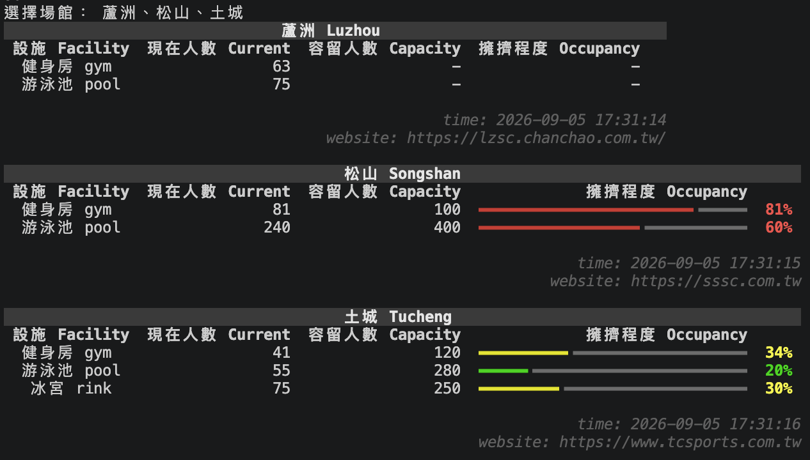

# Taipei Sports Occupancy

A Python command-line tool for checking sports center occupancy in Taiwan. Query gyms, swimming pools, and ice rinks, compare occupancy in the terminal, and save snapshots locally for historical analysis.

The site registry covers 38 sports centers across Taipei, New Taipei, Taoyuan, Hsinchu, and Taichung.



[See the step-by-step usage guide](#usage)

## Features

- Query multiple sports centers using Chinese or English names.
- Normalize occupancy readings from JSON APIs, HTML pages, and plain-text responses.
- Display current attendance, capacity, and color-coded occupancy bars with source links.
- Append readings to monthly CSV files and a local SQLite database.

## Installation

Requirements: Python 3.14 and an internet connection to retrieve occupancy data.

Clone the repository and create a virtual environment:

```bash
git clone https://github.com/kaichiwei/taipei-sports-occupancy.git
cd taipei-sports-occupancy
python3 -m venv .venv
```

Activate it on macOS or Linux:

```bash
source .venv/bin/activate
```

On Windows, use `python` in place of `python3` when creating the environment, then activate it in PowerShell with `.venv\Scripts\Activate.ps1`.

Install the dependencies and the local package:

```bash
python -m pip install -r requirements.txt
python -m pip install -e .
```

Both installation commands are needed: dependencies are listed in `requirements.txt`, and the editable installation makes the package under `src/` available to the application.

## Usage

After completing the installation steps:

1. Open a terminal in the repository root and activate the virtual environment.
2. Start the application:

   ```bash
   python project.py
   ```

3. At the `選擇場館：` prompt, type one or more sports center names and press **Enter**:

   ```text
   選擇場館： 蘆洲、松山、土城
   ```

4. Wait for the selected centers to be queried. Read each center's terminal table to see current attendance, capacity, and the color-coded occupancy percentage. The query timestamp and source website appear below each table.
5. Find the saved readings in `data/log_YYYY-MM.csv` and `data/occupancy.db`. Open the CSV in a spreadsheet application or inspect the SQLite database with a database viewer. See [Data storage](#data-storage) for field definitions and missing-data behavior.

The application saves the results automatically and exits after each query. To check again, run `python project.py` and enter the centers you want to query; each run appends another snapshot.

### Entering sports center names

Chinese and English names can be mixed:

```text
選擇場館： Luzhou, 松山, Tucheng
```

- Separate names with `，`, `、`, `；`, `,`, or `;`.
- English names are case-sensitive: use `Luzhou`, not `luzhou`.
- Chinese names also accept the suffixes `運動中心` and `國民運動中心`; English names accept ` Sport Center` and ` Civil Sport Center`.
- Repeated names for the same center are queried only once per run.
- Unrecognized names are reported along with the available names. Recognized entries are still processed.

## Supported sports centers

The following centers are configured in the [site registry](src/taipei_sports_occupancy/sites.py), which also contains their English names and source URLs.

| City | Count | Centers |
| --- | ---: | --- |
| Taipei | 13 | 大安、大同、中正、松山、萬華、南港、中山、內湖、文山、信義、北投、士林、新生 |
| New Taipei | 17 | 板橋、新店、淡水、泰山、蘆洲、五股、汐止、永和、林口、三峽、鶯歌、台北大學、中和、新莊、樹林、三重、土城 |
| Taoyuan | 5 | 蘆竹、楊梅、桃園、中壢、八德 |
| Hsinchu | 1 | 竹光 |
| Taichung | 2 | 朝馬、北屯 |

Available facilities and readings depend on each center's data source.

## Terminal output

Each table shows the facility, current attendance, capacity, and occupancy percentage (`current / capacity × 100%`). The table caption includes the query timestamp and source website.

| Occupancy | Color |
| --- | --- |
| Below 30% | Green |
| 30% to below 60% | Yellow |
| 60% to below 100% | Red |
| 100% or above | Purple |

Facilities without a current attendance reading are omitted from the table. If capacity is unavailable, both capacity and occupancy are displayed as `-`.

## Data storage

Results are appended to two local destinations under `data/`:

| Format | Destination | Contents |
| --- | --- | --- |
| CSV | `data/log_YYYY-MM.csv` | One row per facility with an available current attendance reading, grouped by query month. |
| SQLite | `data/occupancy.db`, table `occupancy_records` | One row per normalized facility, including entries with missing readings. |

Both formats use these fields; SQLite also includes an integer primary key named `id`.

| Field | Description |
| --- | --- |
| `timestamp` | Local date and time recorded before querying each center, in `YYYY-MM-DD HH:MM:SS` format. |
| `city` | City identifier: `TPE`, `NTPC`, `Taoyuan`, `Hsinchu`, or `Taichung`. |
| `name_zh` | Chinese sports center name. |
| `name_en` | English sports center name. |
| `facility` | `gym`, `pool`, or `rink`. |
| `current` | Current attendance reported by the source. |
| `capacity` | Maximum capacity, when available. |

Missing capacity values are empty in CSV. Missing readings are stored as `NULL` in SQLite; they are distinct from an attendance of zero. SQLite can include placeholder rows for facilities with no source data, so its row count may differ from the CSV output.

Example CSV:

```csv
timestamp,city,name_zh,name_en,facility,current,capacity
2026-09-05 17:31:14,NTPC,蘆洲,Luzhou,gym,63,
2026-09-05 17:31:14,NTPC,蘆洲,Luzhou,pool,75,
2026-09-05 17:31:15,TPE,松山,Songshan,gym,81,100
2026-09-05 17:31:15,TPE,松山,Songshan,pool,240,400
```

Repeated runs append new rows without deduplication. Paths are relative to the working directory, so run the application from the repository root and keep the `data/` directory in place. A [sample CSV](data/sample_occupancy.csv) is included in the repository.

## Data sources and limitations

- Readings come from sports center websites and APIs. Their availability and freshness depend on the source, and website changes may require parser updates.
- Timestamps use the computer's local timezone and record when a query started, not when the source last updated its reading.
- Some capacities are configured in the site registry rather than retrieved with the current attendance.
- Connection failures are reported per center so other selected centers can still be processed. An incomplete response can also result in missing readings.

## Development

After completing the installation steps, run the test suite from the repository root:

```bash
python -m pytest
```

The tests cover site lookup, fetching, parsing, and CSV storage. HTTP requests in the fetcher tests are mocked; the suite does not verify live website availability.

```text
taipei-sports-occupancy/
├── project.py                      # Interactive entry point
├── pyproject.toml                  # Package configuration
├── requirements.txt               # Runtime and test dependencies
├── src/taipei_sports_occupancy/
│   ├── __init__.py
│   ├── sites.py                   # Site names, URLs, and source configuration
│   ├── site_lookup.py             # Input parsing and name matching
│   ├── fetchers.py                # HTTP requests
│   ├── parsers.py                 # Source-specific parsing
│   ├── models.py                  # Shared occupancy data models
│   ├── occupancy.py               # Fetching and parsing coordination
│   ├── terminal.py                # Rich terminal tables
│   ├── csv_storage.py             # Monthly CSV logs
│   └── db_storage.py              # SQLite storage
├── tests/
├── data/
│   └── sample_occupancy.csv
└── docs/
    └── example-output.png
```

## Contributing

Bug reports, parser fixes, and support for additional sports centers are welcome. For incorrect or missing readings, [open an issue](https://github.com/kaichiwei/taipei-sports-occupancy/issues) with the center name, source URL, observed output, and expected result.

To add or update a sports center:

1. Add or update its configuration in `src/taipei_sports_occupancy/sites.py`.
2. Extend the fetcher or parser if the source uses an unsupported format, preserving the shared `FacilityReading` model.
3. Add tests with representative responses and mocked HTTP requests, then run `python -m pytest` before submitting a pull request.
